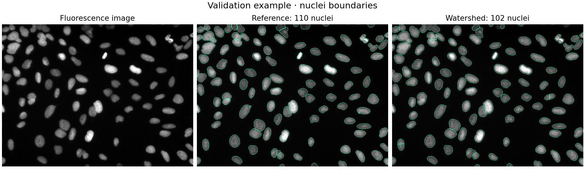
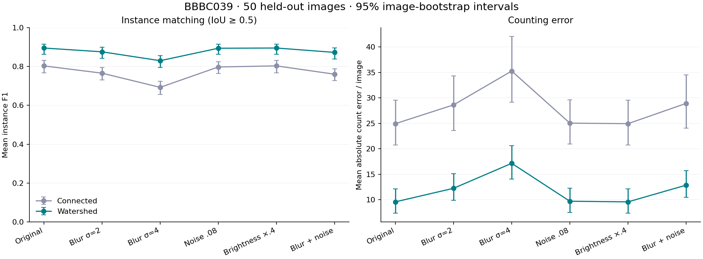
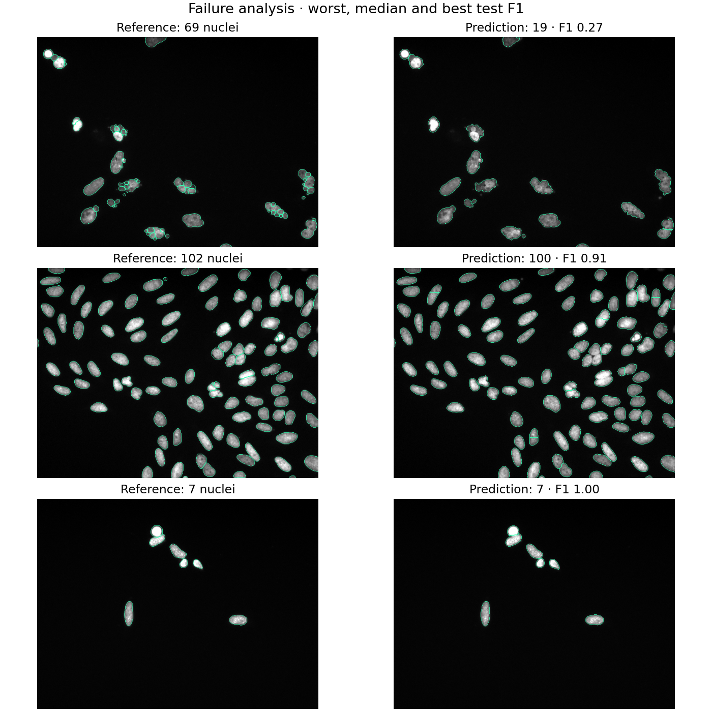

# Nuclei Lab · Cell Counter & Quality Check

**How much does nucleus counting degrade when microscopy images get blurry?**

An end-to-end bioimage analysis portfolio project: segment fluorescent nuclei, measure their morphology, compare two interpretable computer vision baselines, and stress-test them on held-out annotated images. Includes a Streamlit demo, command-line exports, automated tests and reproducible experiment outputs.



## Main result

On the **50-image official BBBC039 test split**, validation-selected watershed segmentation achieved **0.896 mean instance F1** (IoU ≥ 0.5) and **9.60 nuclei/image count MAE**. Connected components achieved 0.804 F1 and 24.94 count MAE. Under Gaussian blur σ=4 pixels, watershed F1 fell to 0.830 and count MAE rose to 17.16.

| Method / condition | Count MAE ↓ | Mean instance F1 ↑ | Foreground Dice ↑ |
|---|---:|---:|---:|
| Connected components · original | 24.94 | 0.804 | 0.945 |
| Watershed · original | 9.60 | 0.896 | 0.953 |
| Watershed · blur σ=2 | 12.26 | 0.876 | 0.930 |
| Watershed · blur σ=4 | 17.16 | 0.830 | 0.878 |
| Watershed · noise σ=.08 | 9.72 | 0.894 | 0.953 |
| Watershed · brightness ×.4 | 9.60 | 0.896 | 0.953 |
| Watershed · blur σ=2 + noise σ=.08 | 12.88 | 0.873 | 0.930 |

Watershed reduced count MAE by **61.5% relative to connected components** on original test images. This is a comparison of these two baselines on one dataset, not a comparison with state-of-the-art systems.

Brightness scaling is intentionally a control: percentile normalization cancels uniform intensity scaling. It does **not** establish robustness to lower exposure, shot noise or detector quantization. Detailed metrics and 95% image-bootstrap intervals are available in [summary.csv](reports/summary.csv).



## Try the demo

Python 3.11+; the recorded run used Python 3.12. Tested package versions are in `reports/run_metadata.json` and `requirements-lock.txt`.

```bash
python -m venv .venv
# macOS / Linux
source .venv/bin/activate
# Windows PowerShell: .venv\Scripts\Activate.ps1
python -m pip install -e '.[dev]'
python -m streamlit run app.py
```

Three original 16-bit BBBC039 validation images are bundled: the demo works without downloading the full dataset. You can also upload a single 2D PNG, JPG or TIFF, adjust segmentation parameters, add blur/noise, and export a measurements CSV, labeled TIFF or boundary overlay. Sliders are exploratory; published benchmark metrics use frozen configurations.

## Reproduce the experiment

```bash
python scripts/download_data.py
python scripts/benchmark.py
python -m pytest -q
```

The downloader retrieves approximately 81 MB from Broad and verifies SHA-256 checksums. The experiment searches four connected-component configurations and eight watershed configurations on **validation only** (50 images), then evaluates all 50 test images under six conditions. The 100 training images are reserved because these classical methods do not require training.

For command-line segmentation:

```bash
cell-counter examples/validation_01.tif --output outputs --min-area 40 --min-distance 10 --threshold-factor 0.7
```

The parameter values above reproduce the selected watershed configuration. Results are `measurements.csv`, `labels.tif` and `overlay.png`. Areas are in px² and lengths in pixels; physical measurements require pixel-size calibration.

## Why two methods?

Connected components counts each connected foreground region as one nucleus, so touching nuclei can merge. Distance-transform watershed places markers inside foreground objects and partitions merged regions. This often improves counts, but excessive markers can split a single irregular nucleus.

Counting error alone can hide compensating false splits and misses. Pixel Dice can look high even when several nuclei are merged. Instance F1 uses one-to-one region matching and makes these failures visible.

## Failure analysis

The figure below shows the worst, median and best original test images by watershed instance F1. It is generated automatically rather than hand-picked.



## Repository map

| Path | Purpose |
|---|---|
| `cell_counter/` | Segmentation, morphology, dataset decoding, instance metrics and CLI |
| `app.py` | Interactive local Streamlit demo |
| `scripts/download_data.py` | Dataset download, checksums and safe extraction |
| `scripts/benchmark.py` | Validation selection, held-out evaluation, stress tests and figures |
| `notebooks/walkthrough.ipynb` | Short annotated walkthrough using bundled images |
| `reports/` | Executed outputs, per-image metrics, configurations and environment |
| `examples/` | Three CC0 validation images and provenance manifest |
| `tests/` | Tests covering splits/merges, mask decoding, 16-bit input and empty images |
| `docs/METHODS.md` | Evaluation protocol and limitations |
| `docs/PORTFOLIO.md` | Accurate project wording and interview notes |

## Scope and limitations

This is a **classical computer vision research prototype**, not a trained neural network, whole-cell counter or diagnostic system. It targets bright fluorescent nuclei on dark backgrounds. Evaluation is restricted to one U2OS screen; generalization to another laboratory, cell line or imaging modality is untested. Quality metrics are descriptive and are not a calibrated reliability score. The project uses AI-assisted implementation; contributors should describe their actual involvement accurately.

## Data and references

We used BBBC039v1, Caicedo et al. 2018, available from the [Broad Bioimage Benchmark Collection](https://bbbc.broadinstitute.org/BBBC039), with collection reference Ljosa et al., Nature Methods 2012. The source images and annotations are CC0. Mask decoding follows [Broad's linked reference example](https://gist.github.com/jccaicedo/15e811722fca51e3ae90e8b43057f075).

Implementation references: [scikit-image segmentation](https://scikit-image.org/docs/stable/api/skimage.segmentation.html), [region measurements](https://scikit-image.org/docs/stable/api/skimage.measure.html), and [SciPy linear assignment](https://docs.scipy.org/doc/scipy/reference/generated/scipy.optimize.linear_sum_assignment.html).

Code is MIT-licensed. Bundled source images retain their CC0 designation.
