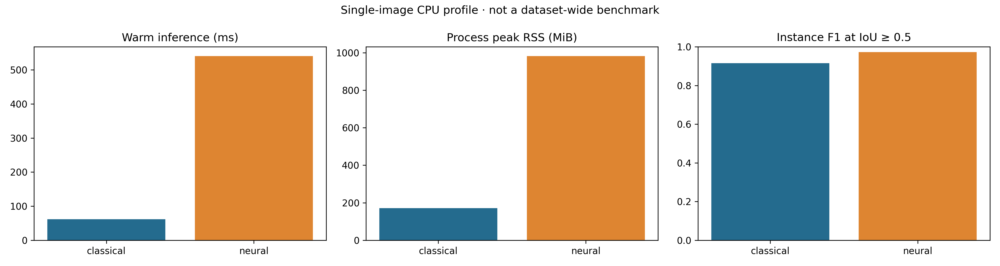

# CPU engineering smoke comparison

Executed on `examples/validation_01.tif`, the first official validation image, with its BBBC039 annotation. This is **one validation image**, not a new held-out dataset-wide neural benchmark. Do not combine these F1 values with the 50-test-image averages in the main results.

Command (after downloading the full dataset and installing the neural extra):

```bash
python main.py --config config.yaml --model both \
  --truth data/bbbc039/masks/IXMtest_A02_s1_w1051DAA7C-7042-435F-99F0-1E847D9B42CB.png \
  --output outputs/comparison --repeats 5
```

| Method | Instance F1 | Precision | Recall | Warm median (ms) | Peak process RSS (MiB) |
|---|---:|---:|---:|---:|---:|
| Watershed | 0.915 | 0.951 | 0.882 | 61.67 | 170.98 |
| StarDist pretrained | 0.972 | 1.000 | 0.945 | 540.85 | 982.77 |



The numbers establish that both implementations run and that the reporting pipeline measures a real difference. They do not establish a deployment recommendation, crossover point or generalization result. Hardware and package versions are recorded in `environment.json`.

Inference timings include each method's preprocessing and instance postprocessing, exclude initialization and exports, and use five repeats after the cold first inference. Initial loading and cold inference are separate columns. Model weights were already cached for this run. CPU thread environment variables are set to one; TensorFlow intra/inter-op threads are also set to one. Native libraries can still have implementation-specific scheduling.

Peak RSS uses the isolated worker's OS process high-water mark. It includes interpreter, imported dependencies, image data, model initialization, repeated inference and exports; it is **not** incremental model memory or GPU VRAM. A separately sampled RSS column is null when unavailable in the execution environment. No CPU timing is transferable to other hardware without rerunning.

StarDist uses `2D_versatile_fluo`, its pretrained weights, bundled probability/NMS thresholds, and its documented percentile normalization. The classical strategy retains the existing validation-selected configuration. No neural parameters were tuned. The common perturbation is applied before method-specific preprocessing. Pretrained-data overlap has not been audited, so this run must not be described as an independently trained or leakage-audited model comparison.
